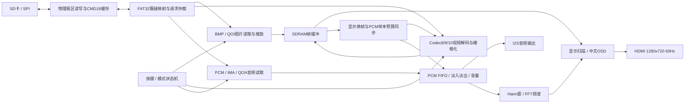

# v114 整机数据流与阅读顺序

当前生产架构为纯RTL，无软核。下面是功能关系图，省略复位、握手和部分缓冲；准确接口与实际参与综合的文件以顶层、工程清单和manifest为准。

## 时钟与缓冲边界

本次core为100MHz、SDRAM写侧125MHz，HDMI像素/串化相关时钟为74.25/371.25MHz。HDMI60Hz是显示刷新率；当前媒体编码为15fps，不能将两者混用。复位/跨域处理沿用冻结工程，不因为功能仿真通过就视为全部跨域和布线时序已经证明。

视频先提交完整帧，显示侧切换帧缓冲；`av_sample_sync`根据已显示帧授权音频样本预算，样本消费推动下一帧请求。供数不及时会等待，可能表现为帧间隔不均或听感间断。该机制限制音频越过画面，并不能创造额外SD带宽。

## 本次修改放在哪里

- `rtl/storage/sector_byte_source.v`：等待仲裁与已授权交易分开计时；512字节完整后发布；短读在原位置有限重试。实际公开映射以MODULES和manifest为准。
- `rtl/top/top_tf_hdmi_audio.v`：保留正常选轨控制，删除确认后的单独音轨从头重选；锁存故障代码便于板测记录。
- `host/video/src/refine_boundaries.cpp`：离线相邻块代表色联合拟合，兼容现有Codec10解码，无生产RTL新增模式。
- `research/gradient_codec11`：独立实验，未进入工程清单，当前bit不能播放其输出。

先读README和RELEASE_V114，再按MODULES定位顶层、存储、视频和音频。公开源码通过manifest映射还原到完整工程；厂商IP单独导入。详见BUILD、VALIDATION及依赖说明。

本版setup −1.980ns、338违例端点，时序未闭合。大范围功能仿真不等于实板可靠性验收。
