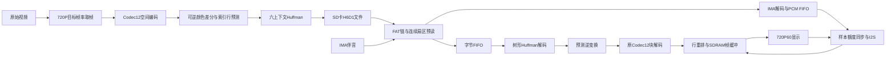

# 720P30 架构与验证说明（2026-10-30）

目标是在维持当前Codec12空间画质的条件下，把独立内容帧提升到1280×720、30fps。显示接口仍是720P60；两次扫描展示一张新内容帧。本文描述研究候选，是否通过验证以对应哈希清单为准。

## 数据通路

视频和音频共享SD总线。FAT映射器把文件逻辑扇区映射到物理扇区，保留各客户端游标；物理预读可跨文件碎片边界读取额外扇区，但缓存只按准确物理LBA命中，实际需要的下一扇区仍由FAT链确定。卷尾保护限制推测性读卡范围。

## 编码精度与格式

离线编码仍使用生产参数`500 8000 125000 15`，末项为允许模式掩码。此阶段本身是有损块编码，H6D1不会消除原有块感。第二阶段只做可逆变换和熵编码，回解后的Codec12 token必须完全相同。

颜色代表值以RGB565整字进行模65536差分；块内索引按前一行异或。预测器在每帧重置，索引行预测在块边界重置。不存在跨帧参考图像或长期预测误差扩散。

六上下文分别处理操作码、颜色低/高字节、两类索引字节、附加模式字节。冻结规范Huffman码表与RTL ROM成套。硬件用同步二叉树ROM逐位遍历，避免大规模规范码算术比较链。每个内部节点含左右子节点信息，叶节点还原一个字节。

文件头为512字节，关键字段如下：

| 偏移 | 长度 | 含义 |
|---:|---:|---|
| 0 | 4 | ASCII `FPGV` |
| 4 | 1 | 版本1 |
| 5 | 1 | 格式14 |
| 6 | 2 | 宽，1280，小端 |
| 8 | 2 | 高，720，小端 |
| 10 | 2 | 内容帧率，小端 |
| 12 | 4 | 声明文件长度，不含尾部扇区填零 |
| 16 | 4 | 帧数 |
| 20 | 4 | ASCII `H6D1` |

当前文件不携带完整码表。因此不能只替换码表文件而不重编配套RTL；v183也不能读取格式14。生产禁用的gradient操作码134在封装时被拒绝。

## 带宽结果与边界

CS全片271.2秒，8136帧。完整视频601,860,608字节，IMA伴音6,531,188字节。H6D1视频载荷比同一Codec12编码结果减少36.95%；平均每帧73,974.91字节，最大81,745字节。

SPI有效载荷按32个核心周期每字节建模。核心约90.9MHz，对应SPI约22.7MHz。模型还显式计入命令、首令牌、块间令牌/CRC、CMD12及600字节收尾。600字节是原板级修复的一部分，本轮不削减，避免重新引入未清空数据污染下一请求的问题。

全片最高码率一秒从225.0秒开始，视频约2,446,393字节/秒。在首响应40,000核心周期的模型中，32扇区预读的纯传输估算占101.18%，48扇区占97.77%。这些是理想缓存复用的估算，尚未计FAT查询、仲裁、解码等待；必须以最重片段RTL和真实卡测试核实，不能用全片平均值替代峰值检查。

当前 residual_hybrid64_lutqoi 使用 64 扇区、32KiB 物理缓存：前 28KiB 显式实例化 7 块 BRAM32K，尾 4KiB 用 4 块 BRAM9K。解码端 16KiB 压缩字节 FIFO 保留。两类存储均保持同步读取及写冲突转发语义，已经厂商模型与独立字节记分板比较。

QOI 的 64×32 位索引只有 256 字节，从独占一块 BRAM32K 改为 EG_LOGIC_DRAM 分布式存储，并寄存输出以保持延迟。这是利用剩余 LUT 换取大块 RAM 的具体改进。全 QOI 指令、随机停顿、连续启动以及实际图片读取/缩放/写入链分别验证，图片空间编码和适配策略不变。

音频与视频/图片各自保留 FAT 页缓存，避免不同 FAT 页相互驱逐；物理 SD 总线仍共享，不代表可同时执行两条 SD 命令。综合 LUT 17695/19600（90.28%）、BRAM9K 63/64、BRAM32K 16/16；布局 slice 占用 9342/9800（95.33%），不能把 slice 百分比当成 LUT 百分比。

此前 56 扇区候选虽通过 90 帧，在 300 帧连续峰值出现 5 个 50ms 间隔，已判失败。因此当前以两组 300 帧测试和完整厂商模型 30 帧复核作为交付门禁，不靠启动缓冲掩盖持续吞吐不足。

实测峰值RTL暴露批量交付阻塞：原扇区读取器虽已输出第一扇区，但其结束握手需等全部预读和CMD12完成，导致后续缓存无法及时送到解码器。`residual_streamcache`候选在第512字节后返回第一笔逻辑结束，另一个小状态机从双口缓存读取已完整接收的扇区；物理SPI继续填充。缓存未命中请求等待当前CMD18清理完成。读范围、完整扇区门限、请求撤销、慢速消费和物理结束与逻辑结束重合都需要独立检查。它未提高SPI时钟或削减收尾字节。

## 等待显示区时预读与音频准入

逐扇区交付之后，streamcache候选在最高码率整秒的最后一帧仍迟到0.520487ms，导致显示间隔扩大到50ms。诊断确认音频请求在视频物理CMD18仍忙时获准，会持有共享仲裁器并挡住已完整写入的缓存视频扇区；同时V_REQ等待可写SDRAM银行时没有继续填充独立的压缩字节FIFO。

`residual_waitread_r2`在已有显示帧或就绪帧、字节FIFO低于高水位、没有在途请求时，允许V_REQ继续取压缩字节。像素缓冲区所有权条件未放宽。首帧仍等待原SETTLE流程，避免文件头派生的长度流水尚未稳定就锁存read_last。最初无条件预读版本因此失败，保留失败证据，不用于交付。

`residual_overlaparb`在上述修复上增加可选仲裁策略：视频已播放且PCM写域储备至少4096字节，并且物理SD状态为19/20/23时，用寄存条件延后新的音频请求。低储备或启动立即恢复音频资格；早期等待计数饱和于1000000核心周期后也恢复资格；当前64扇区候选上限为1400000核心周期（约15.4ms）。已接受请求的地址、owner和结束握手不撤销。模块默认关闭此策略，保持旧实例行为。

4096字节相当于48kHz立体声约21.3ms或单声道42.7ms的PCM。64扇区纯载荷传输约11.5ms，另需命令、令牌和收尾开销，但这个估计不是任意SD卡延迟上限，实际欠供仍须由完整播放测试和上板验收判断。保留原SPI频率、CMD12和600字节清理。

## 显示与声音节奏

每张实际展示的新视频帧授予一帧PCM样本额度，30fps对应1600样本。消费进度产生下一帧许可。这样在读卡阻塞时不会让声音无限领先图像。

最新`residual_scanack`候选把解码完成和显示提交分离。一个完成帧槽保存待显示缓冲区编号，允许第三块SDRAM缓冲区提前接收下一帧；开播等待两帧解码完成，只有一帧的文件直接播放。解码末帧计数与显示末帧标记独立，避免预解码触发提前轮播。

旧的延迟vsync通知晚于实际SDRAM读帧请求，不能单独证明旧显示缓冲区已经释放。新读控制器在S_ACK退出、实际基地址锁存的同一拍发布缓冲区编号和事件翻转；顶层同步编号与事件后，按实际读取编号授予音频额度、释放旧显示区。未收到匹配的新帧读反馈前，不重复提交显示或重写旧显示区。两帧预缓冲和实际读反馈只改变调度，不修改视频量化或丢弃PCM样本。

原高帧率启动许可在半帧，即16.667ms，恰好靠近60Hz刷新边界。时钟相位和解码完成时刻变化可让新画面提前一拍。修正后高帧率启动许可在四分之三帧，即30fps下25ms，居于相邻刷新之间。样本不被跳过，低帧率原逻辑保留。

音频PLL实际比名义48kHz略快。等待下一张视频授予额度时，原I2S会输出零，形成周期性的极短静音。新增可选`MAX_BUDGET_HOLD`，默认0保持旧模块接口行为；实验top设2，仅在音频域视频额度为空时最多保持两个完整采样对。保持不产生sample_valid、不消费PCM，无法隐瞒长时间欠供；mute、flush和普通SD欠供仍按原路径处理。此方法是有界零阶保持，不是高阶重采样器。

本实验配置支持PCM和IMA伴音，不启用QOA硬件，节省资源供视频通路使用。图片QOI与音频QOA是不同功能，图片QOI保留。

## 时序与验证方法

1. TD完成布线后，在新的工具进程中重新打开数据库、加载原SDC、核对全部9个时钟。此前工具同进程重载约束会出现时钟退化，正WNS不能直接用于签核。
2. 记录setup/hold、违反端点数、源文件/约束/位流哈希。没有增加假路径或放宽最终时钟约束。
3. 对资源删减导致的覆盖率百分比变化，逐类比较check_timing和异步组，保留报告哈希。原有外部IO延迟缺失、SDRAM输入诊断与FIFO例外不会因此变成已签核。
4. 用旧版失败、新版通过的同一测试证明节奏修复；小像素长测覆盖8136帧控制和EOF，真实720P测试逐像素/逐PCM样本比较，并逐个检查显示间隔。
5. SD引脚级测试验证协议、预读、取消和错误恢复；FAT测试覆盖碎片链、寻址、多个owner、卷尾；I2S测试覆盖时钟比例、多个相位、静音、清空及有限保持。
6. 对最终候选复用证据时逐文件比SHA，修改过的模块不能直接沿用旧结果。logo ROM以全部2048地址的逐拍等价证明替代旧越界夹取逻辑。

全片文件回解、长控制链、短真实720P链和音频输出测试是组合证据，不等于整部视频完整整机RTL仿真。最终还需板上全片播放、重复切换、退出回音乐和不同卡延迟下的验收。
